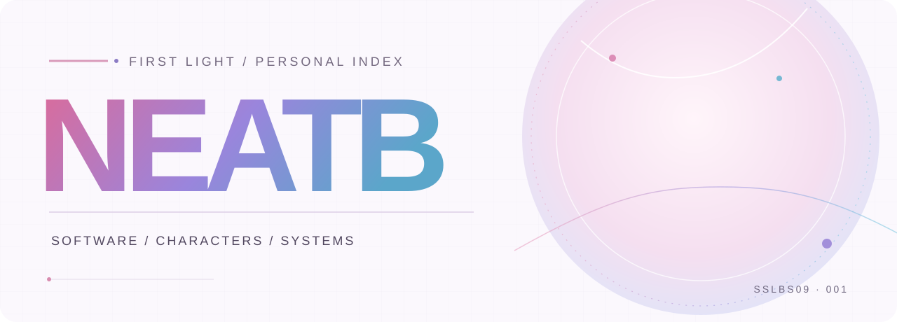
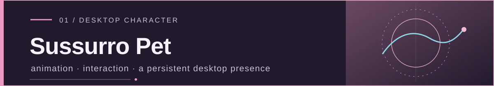
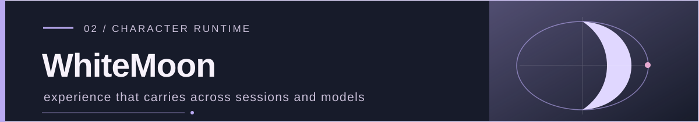
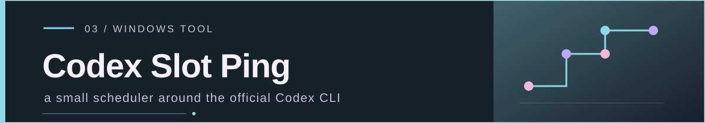
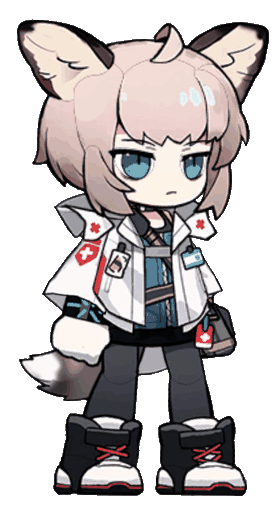
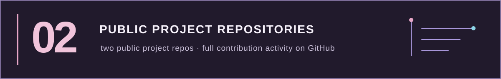

  <picture>
    <source media="(prefers-color-scheme: dark)" srcset="./assets/hero-dark.svg" />
    <source media="(prefers-color-scheme: light)" srcset="./assets/hero-light.svg" />
    
  </picture>

<strong>Now, we are to begin.</strong> 中文：现在，我们即将开始。

## 01 / Featured work

A desktop character project with GIF, Spine, 2.5D and Live2D rendering, desktop interaction, and local memory.

Character Runtime research: persistent state and experience across sessions, restarts, and model changes, so the past can shape future behavior. Designed to work independently of a particular Agent Harness.

A Windows tray tool that schedules planned requests through the locally installed official Codex CLI.

## 02 / Sussurro, in motion

  

<strong>A small, real idle loop.</strong> 2.8 seconds · transparent GIF · soft blink, gentle tail sway, rendered from the existing Spine rig.

<a href="https://github.com/sslbs09/suzuran-pet">Meet her in Sussurro Pet ↗</a>

## 03 / About

I’m a student and independent developer, learning by building real software. I move between embedded systems, desktop apps and AI agents, with a particular interest in animated characters and memory that can shape what happens next.

## 04 / Learning

- **Software:** software engineering · system design · desktop application development
- **Embedded & control:** C · STM32 · PLC · industrial automation
- **Agents & characters:** AI agents · Character Runtime · persistent state and memory

## 05 / GitHub activity

[View my live GitHub profile and contribution activity ↗](https://github.com/sslbs09)

NEATB · Now, we are to begin.

